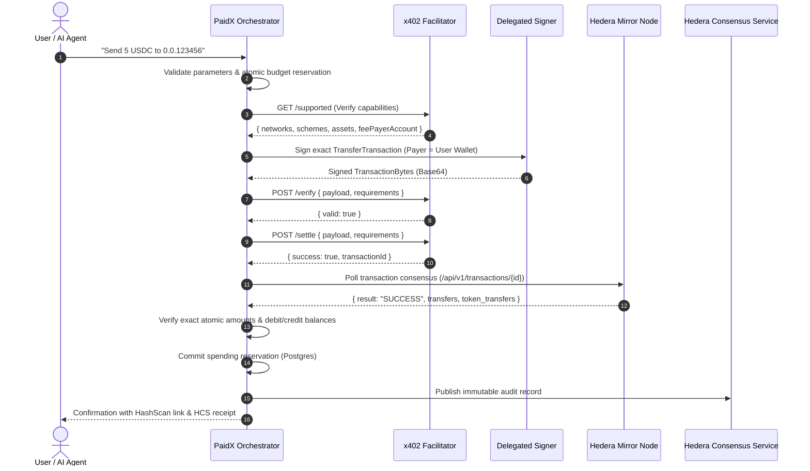

# Hedera x402 Exact Scheme Payment Protocol: Compliance & Implementation Report

**Standard:** Hedera x402 Exact Payment Scheme Specification  
**Version:** 1.0.0  
**Implementation Modules:**  
- `dashboard/lib/hedera/x402/requirements.ts`
- `dashboard/lib/hedera/x402/facilitator.ts`
- `dashboard/lib/hedera/hts.ts`
- `dashboard/lib/agent/orchestrator.ts`

---

## 1. Protocol Architecture & Flow

The Hedera x402 exact payment scheme enables HTTP-native, conversational cryptocurrency settlements where an autonomous AI agent acts on behalf of an authorized user wallet.

---

## 2. Specification Compliance Checklist

### 2.1 Facilitator Capability Verification (`GET /supported`)
- **Requirement:** Orchestrator must query and verify that the target facilitator supports the requested network (e.g. `hedera:testnet`), scheme (`exact`), and asset ID before generating requirements or signing.
- **Implementation:** `checkFacilitatorCapabilities()` validates `supported.networks`, `supported.schemes`, and `supported.assets`. Fails closed if the facilitator is unreachable or returns an HTTP error.

### 2.2 Removal of Hardcoded Fee-Payer Accounts
- **Requirement:** Eliminate all hardcoded fee-payer strings (such as `'0.0.5449100'`).
- **Implementation:** Fee-payer accounts are resolved strictly from the facilitator's advertised `feePayerAccount` via `/supported` or explicitly configured environment variables. If omitted, the transaction payer account is utilized.

### 2.3 Strict Zero-Tolerance Transfer Validation
- **Requirement:** Transactions must transfer funds only between the authorized payer and designated recipient. Any extraneous transfers or asset mingling must be rejected.
- **Rules Enforced in `validateTransactionBytesAgainstRequirements()`:**
  1. **Native HBAR Transfer:**
     - Must contain strictly 0 token transfers.
     - Must contain exactly 2 HBAR transfer entries.
     - `payer` transfer must equal `-reqAmountBig`.
     - `recipient` transfer must equal `+reqAmountBig`.
  2. **HTS Token Transfer:**
     - Must contain strictly 0 HBAR transfers.
     - Must contain exactly 1 token asset ID matching `requirements.asset`.
     - Token transfer map must contain exactly 2 entries.
     - `payer` transfer must equal `-reqAmountBig`.
     - `recipient` transfer must equal `+reqAmountBig`.

### 2.4 Cryptographic Signature Verification
- **Requirement:** Unsigned or partially signed transactions must be rejected before facilitator submission.
- **Implementation:** Deserializes transaction bytes into `TransferTransaction` and inspects `tx.getSignatures()`. Ensures signature pairs are registered for all target node account IDs.

### 2.5 Verify-Then-Settle Facilitator Pipeline
- **Requirement:** Facilitator verification must return `valid === true`. Settlement must not proceed if verification fails.
- **Implementation:** Both local structural verification and remote facilitator `/verify` are executed. Fails closed with descriptive errors if `valid !== true`.

### 2.6 Genuine Settlement & Non-Simulated Execution
- **Requirement:** Never simulate or fake x402 settlement.
- **Implementation:** All settlement calls execute against live facilitator endpoints. Network timeouts preserve an `uncertain` status, preventing premature budget release.

---

## 3. Independent Verification via Hedera Mirror Node

After facilitator settlement, the PaidX orchestrator does not solely rely on the facilitator's confirmation. It independently verifies on-chain consensus:
1. Polls Hedera Mirror Node (`/api/v1/transactions/{transactionId}`).
2. Requires Mirror Node to return an indexed transaction.
3. Requires `result === 'SUCCESS'`.
4. Inspects on-chain transfer arrays:
   - Verifies recipient account was credited the exact atomic amount.
   - Verifies payer account was debited the exact atomic amount.
   - Verifies token ID matches the requested asset.
5. Budget reservation is committed **only** after this independent verification succeeds.

---

## 4. Test Matrix & Protocol Proofs

All x402 compliance criteria are verified in `test/unit/x402_and_facilitator.test.ts`:
- `Test Case 11: verifies valid payload matching exact requirements` -> PASS
- `Test Case 11: rejects unsigned payload` -> PASS
- `Test Case 11: rejects payload with amount mismatch (greater amount)` -> PASS
- `Test Case 11: rejects payload with amount mismatch (lesser amount)` -> PASS
- `Test Case 11: rejects payload with wrong recipient` -> PASS
- `Test Case 11: rejects payload with wrong asset` -> PASS
- `Security Zero-Tolerance: rejects extra transfers to third-party accounts` -> PASS
- `Security Zero-Tolerance: rejects unauthorized HBAR transfer inside token payment` -> PASS
- `Facilitator Capabilities: rejects unsupported network, scheme, or asset` -> PASS
- `Facilitator Verification: requires facilitator response valid === true` -> PASS
- `Facilitator Verification: FAILS CLOSED when facilitator is unavailable` -> PASS
- `Facilitator Settlement: captures network timeouts without fake settlement` -> PASS
- `Mirror Node Polling: polls and returns transaction when SUCCESS reached` -> PASS
- `Mirror Node Polling: returns null when transaction not yet indexed` -> PASS
