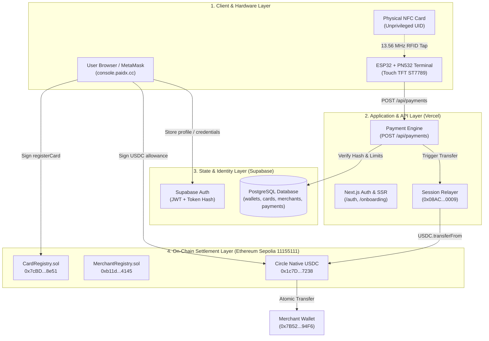
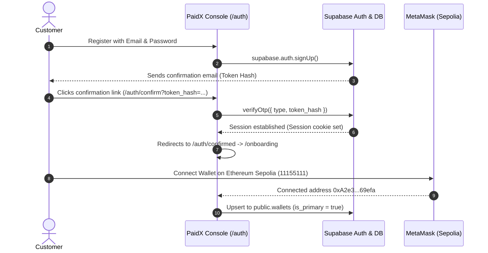
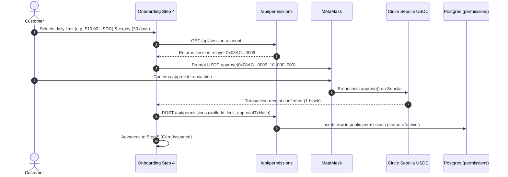
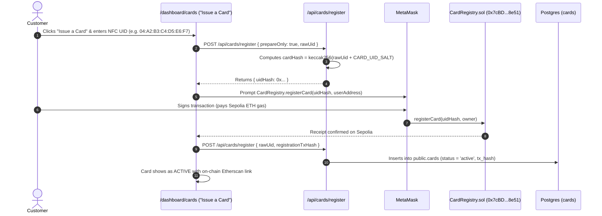
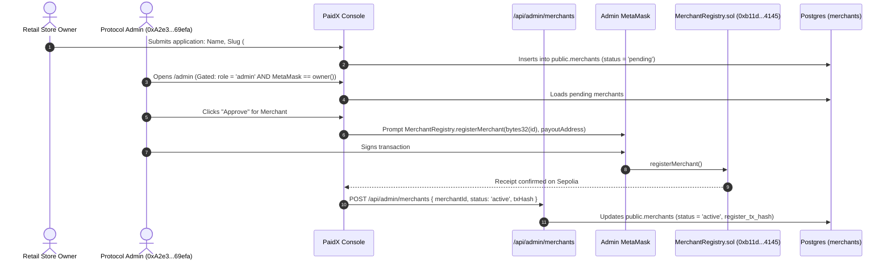
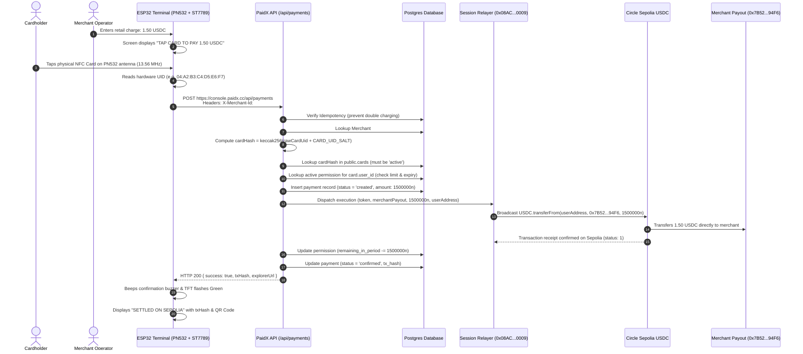

# PaidX System Architecture & Technical Specification

> **Stage**: Production Testnet Implementation  
> **Target Network**: Ethereum Sepolia (`11155111`)  
> **Branch**: `feat/pos-workflow`  
> **Production Endpoints**:
> - Web Console / API: `https://console.paidx.cc`
> - Marketing & Landing: `https://paidx.cc`
> - Official Payment Token: Circle Sepolia Native USDC (`0x1c7D4B196Cb0C7B01d743Fbc6116a902379C7238`)
> - CardRegistry Contract: `0x7cBD8DE77C16Ba79A1fe10E30913517845D68e51` (Owner: `0xA2e3A301159beA4429c56417aB0856a3f4569efa`)
> - MerchantRegistry Contract: `0xb11dAE79F1B187E95CB93655A983D6e86E574145` (Owner: `0xA2e3A301159beA4429c56417aB0856a3f4569efa`)
> - Backend Session Relayer: `0x08AC38a8655a8Cb9841582CEa092df0F65fF0009`

---

## 1. Executive Summary & Paradigm

**PaidX** is a strictly **non-custodial cryptocurrency retail point-of-sale (POS) protocol** that bridges physical contactless NFC payment cards, standalone hardware POS terminals (ESP32 + PN532), and Ethereum Sepolia smart accounts.

### Fundamental Principles
1. **Absolute Non-Custody (No Middleman Vault)**: PaidX servers and smart contracts **never custody user or merchant funds**. Payments move directly and atomically from the customer's self-custody wallet to the merchant's on-chain settlement payout address.
2. **Account Ownership vs. Execution Delegation**:
   - **Account Ownership**: Retained 100% by the user in their self-custody wallet (MetaMask). Private keys never leave the user's browser or mobile device.
   - **Execution Authority**: The user grants a scoped execution permission (daily rolling spending cap) to PaidX's backend **Session Relayer**.
3. **Hardware UID Privacy & Anonymity**: Physical NFC cards carry zero private keys. The hardware UID is never stored or broadcast in plain text. All contracts and database tables reference a cryptographically salted hash:
   $$\text{cardHash} = \text{keccak256}(\text{abi.encodePacked}(\text{rawCardUid}, \text{CARD\_UID\_SALT}))$$
4. **Verifiable Testnet State**: All balances, approvals, registrations, and transactions are real on-chain events on Ethereum Sepolia, verifiable on Sepolia Etherscan.

---

## 2. High-Level Architecture Diagram

---

## 3. Actors & Trust Boundaries

| Actor | Identification | Permissions & Scope | Key Custody |
|---|---|---|---|
| **User (Payer)** | Supabase `auth.users.id` + MetaMask EOA / Smart Account | Issue physical cards, set daily spending allowance, review payment history | Private key remains in MetaMask. PaidX never sees it. |
| **Merchant** | `public.merchants.id` + `payout_address` | Accept payments at POS, inspect live retail settlement dashboard | Self-custodial. Payout address is verified on-chain. |
| **Protocol Admin** | `profiles.role = 'admin'` AND `MerchantRegistry.owner()` (`0xA2e3...69efa`) | Authorize/suspend merchants on-chain via `/admin` | Private key in admin's MetaMask. No server-held admin keys. |
| **Session Relayer** | `0x08AC38a8655a8Cb9841582CEa092df0F65fF0009` | Submit redeemed card-tap transactions within user-approved limits | Server-held testnet private key (`SESSION_ACCOUNT_PRIVATE_KEY`). Holds small ETH gas balance. |
| **POS Terminal** | Device UUID `#001` + Pre-shared Device Token (`psk_...`) | Read card UID, prompt tap, dispatch sale request to backend | Hardware stores no private keys or seed phrases. |

---

## 4. Key Custody Matrix

| Key / Secret | Storage Location | Capabilities | Risk Assessment | Testnet Only? |
|---|---|---|---|---|
| **User Private Key** | User's MetaMask wallet | Full control over user funds, permissions, card registration | **Zero protocol risk** (non-custodial) | No |
| **Admin Private Key** | Admin's MetaMask wallet (`0xA2e3...69efa`) | Owner of `CardRegistry` and `MerchantRegistry` | **Zero server risk** (signed exclusively in browser) | No |
| **Session Relayer Key** (`SESSION_ACCOUNT_PRIVATE_KEY`) | Server-only environment variable (`console.paidx.cc`) | Submits redeemed card payments; pays transaction gas | **Contained**: Can only transfer USDC up to the user-approved cap to registered merchants | Yes (Testnet relayer) |
| **Deployer Key** (`DEPLOYER_PRIVATE_KEY`) | Local Foundry CLI only | Deploys contracts via `script/Deploy.s.sol` | **Zero runtime risk**: Never present in deployed web app | Yes |
| **POS Device Token** (`PAIDX_DEVICE_TOKEN`) | ESP32 Flash (`paidx_secrets.h`) | Authorizes POS terminal to send payment intents | **Low**: Revocable per terminal; cannot initiate arbitrary transfers | Yes |
| **Supabase Secret Key** (`SUPABASE_SECRET_KEY`) | Server-only environment variable (`console.paidx.cc`) | Backend database administration | **Restricted**: Server-side only; never exposed to client bundles | Yes |

---

## 5. Gas & Settlement Economics Matrix

| Action | Initiator | Transaction Signer | Gas Payer | Currency |
|---|---|---|---|---|
| **Deploy Registries** (`Deploy.s.sol`) | Protocol Admin | Deployer Key | Deployer Key | Sepolia ETH |
| **Account Upgrade** (EIP-7702) | User | User (MetaMask) | User | Sepolia ETH |
| **Card Registration** (`registerCard`) | User | User (MetaMask) | User | Sepolia ETH |
| **Spending Allowance** (`USDC.approve`) | User | User (MetaMask) | User | Sepolia ETH |
| **Merchant Approval** (`registerMerchant`) | Admin | Admin (MetaMask) | Admin | Sepolia ETH |
| **Merchant Status Toggle** | Admin | Admin (MetaMask) | Admin | Sepolia ETH |
| **Card-Tap Retail Settlement** | Customer Tap | Session Relayer | **Session Relayer** | **Relayer pays Sepolia ETH gas**; **User pays exact USDC amount** |

---

## 6. Detailed End-to-End Workflows

### Workflow 1: Customer Onboarding & Wallet Connection

---

### Workflow 2: Spending Allowance & Permission Grant

---

### Workflow 3: Physical NFC Card Issuance

---

### Workflow 4: Merchant Onboarding & Admin On-Chain Approval

---

### Workflow 5: Complete POS Tap-to-Pay Settlement Workflow

---

## 7. Smart Contracts Architecture

### 7.1 CardRegistry (`contracts/CardRegistry.sol`)
- **Address**: `0x7cBD8DE77C16Ba79A1fe10E30913517845D68e51`
- **Owner**: `0xA2e3A301159beA4429c56417aB0856a3f4569efa`
- **Purpose**: Authoritative on-chain registry mapping `cardHash => CardRecord(owner, status, registeredAt)`.
- **Key Functions**:
  - `registerCard(bytes32 cardHash, address owner)`: Binds a card hash to the user's wallet. Reverts if already registered.
  - `setCardStatus(bytes32 cardHash, CardStatus status)`: Callable **only by the card owner** to freeze, unfreeze, or revoke their card.
  - `verifyCardActive(bytes32 cardHash)`: External view function returning `(bool isActive, address owner)`.

### 7.2 MerchantRegistry (`contracts/MerchantRegistry.sol`)
- **Address**: `0xb11dAE79F1B187E95CB93655A983D6e86E574145`
- **Owner**: `0xA2e3A301159beA4429c56417aB0856a3f4569efa`
- **Purpose**: Registry of verified retail merchants and their settlement payout destinations.
- **Key Functions**:
  - `registerMerchant(bytes32 merchantId, address payoutAddress)`: Callable **only by owner** upon KYC/approval.
  - `setMerchantActive(bytes32 merchantId, bool active)`: Callable by owner to pause or activate merchants.
  - `isMerchantActive(bytes32 merchantId)`: External view returning `(bool isActive, address payoutAddress)`.

---

## 8. Hardware POS Terminal Specification

### Component Breakdown
| Hardware Component | Model / Spec | Bus / Interface | Purpose |
|---|---|---|---|
| **Microcontroller** | ESP32-WROOM-32 (38-pin DevKit) | 240 MHz Dual-Core | POS operating system, network stack, UI engine |
| **NFC Transceiver** | NXP PN532 | I2C (SDA: 16, SCL: 17) | 13.56 MHz RFID/NFC contactless card reader |
| **Display Panel** | 2.8" TFT 240x320 SPI | SPI (MOSI: 23, SCLK: 18, CS: 5, DC: 2, RST: 4) | High-contrast retail user interface |
| **Touch Controller** | XPT2046 Resistive | SPI (T_CS: 32) | On-screen PIN and amount numpad entry |

### Firmware Architecture (`esp/esp.ino`)
- **Non-blocking Boot Pipeline**: Initializes display, performs non-blocking WiFi connection with splash screen, and enters ready state.
- **Touch Numpad**: Digit entry for transaction amounts with backspace, clear, and decimal validation.
- **PN532 Auto-Polling**: Continuous non-blocking NFC field polling. When an ISO14443A card enters the RF field, it captures the raw UID.
- **Atomic HTTP Client**: Dispatches an authenticated JSON POST request with exponential backoff and timeout handling:
  - `X-Device-UUID: #001`
  - `X-Merchant-Id: #001`
  - `Authorization: Bearer psk_...`
  - `Idempotency-Key: pos-<timestamp>-<rand>`
- **Live Receipt Rendering**: Displays transaction hash and renders dynamic QR code linking directly to Sepolia Etherscan.

---

## 9. Security Model & Defense in Depth

1. **Anti-Replay Protection**:
   - Every POS request requires a unique `Idempotency-Key`.
   - The database enforces `idempotency_key TEXT UNIQUE`. Replayed requests return the existing confirmed receipt without re-submitting transactions.
2. **Card UID Salting**:
   - Physical UIDs are salted server-side with `CARD_UID_SALT` before storage or contract hashing.
   - Anyone observing on-chain events cannot correlate a `cardHash` to a physical card without the secret salt.
3. **Double-Spend & Limit Protection**:
   - The backend checks `remaining_in_period >= requestedAmount` before broadcasting.
   - On confirmation, `remaining_in_period` is decremented atomically.
4. **Strict BigInt Arithmetic**:
   - All financial amounts use `bigint` with `parseUnits` and `formatUnits`. No floating-point rounding errors exist in the settlement pipeline.
5. **No Intermediate Escrow**:
   - Funds are never routed through a PaidX contract. Settlement is direct peer-to-peer ERC-20 transfer.

---

## 10. Verification Checklist

- [x] **CardRegistry Deployed**: `0x7cBD8DE77C16Ba79A1fe10E30913517845D68e51`
- [x] **MerchantRegistry Deployed**: `0xb11dAE79F1B187E95CB93655A983D6e86E574145`
- [x] **Official Circle USDC Used**: `0x1c7D4B196Cb0C7B01d743Fbc6116a902379C7238`
- [x] **Issue a Card UI Functional**: On-chain MetaMask signing with receipt verification
- [x] **Merchant Linking Unified**: `#001` strictly resolves to `0x7B52dcb074EF9C189BDFb0c19bE7094C277a94F6`
- [x] **On-Chain Settlement**: `USDC.transferFrom(user, merchant, amount)` verified
- [x] **Etherscan Visibility**: Real transaction hashes returned to POS and viewable on Etherscan
